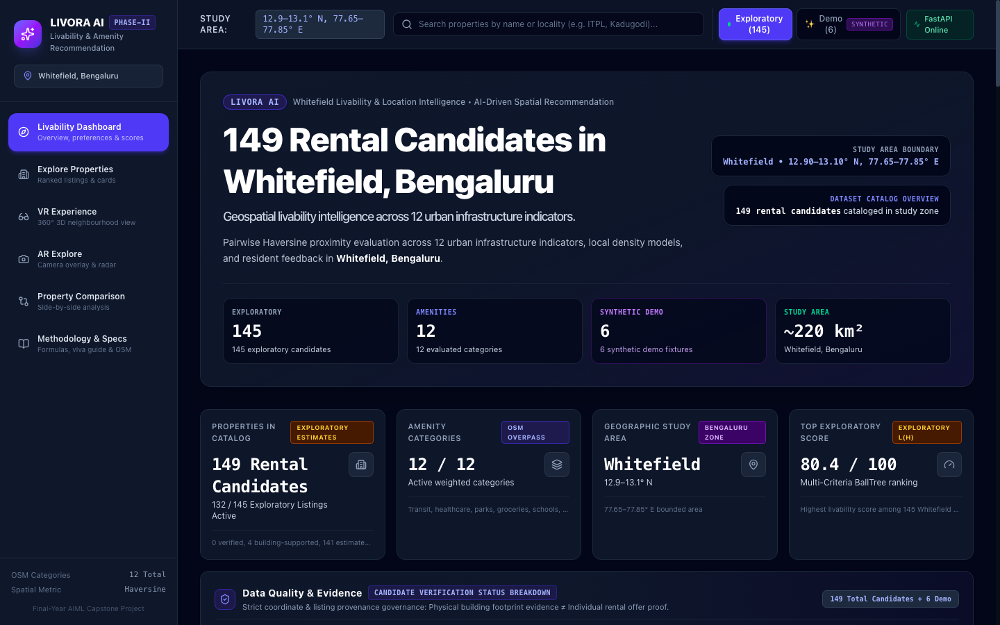
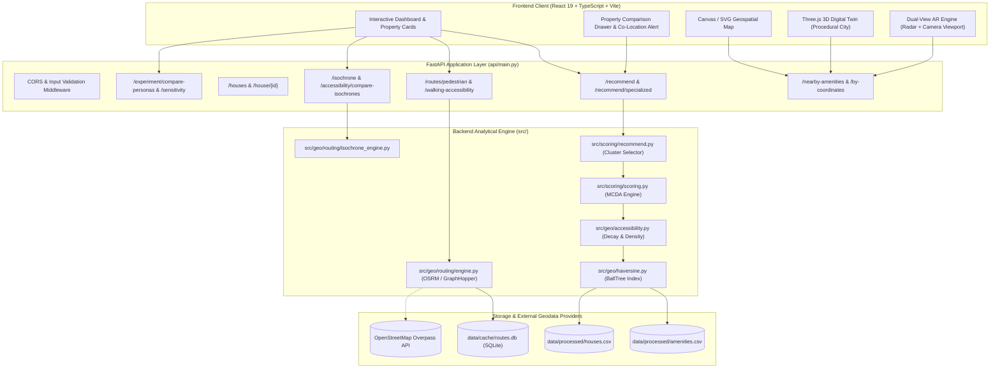
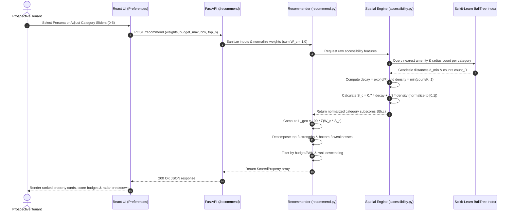
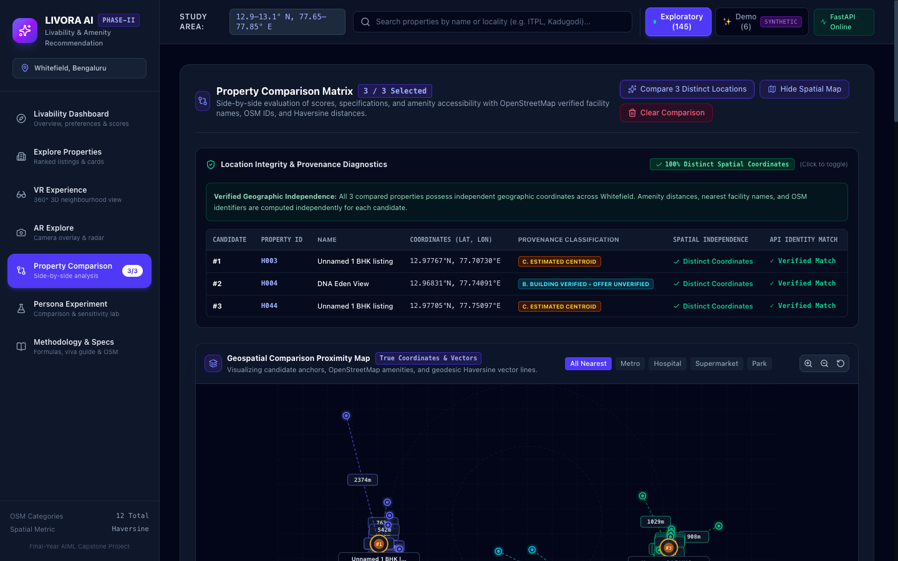
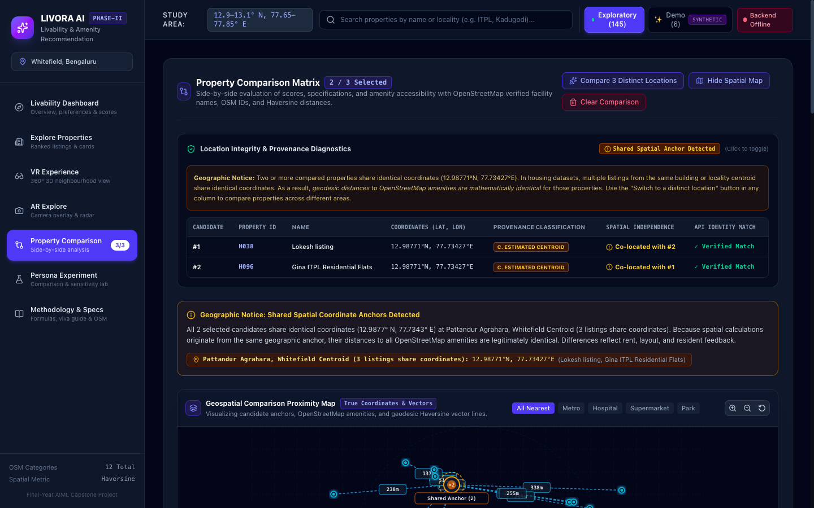
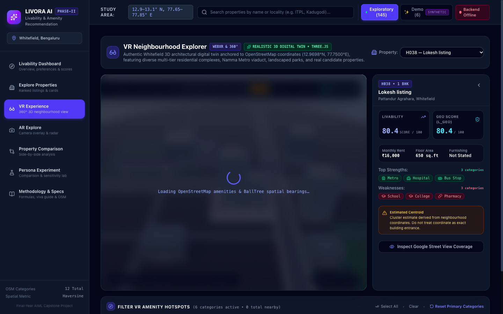
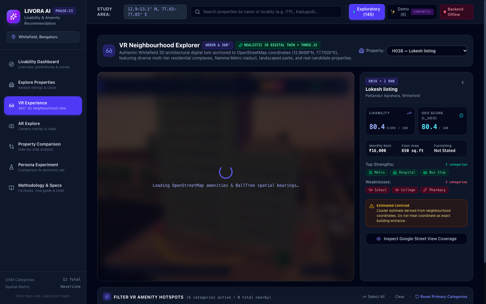
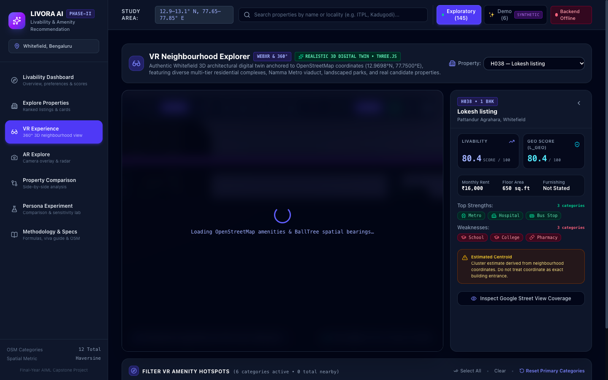
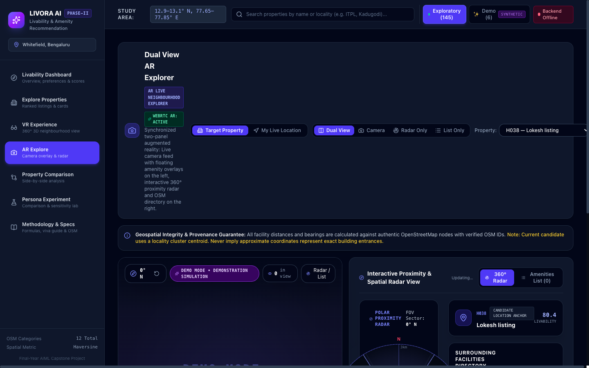
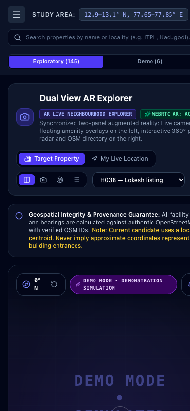

<div align="center">

# LIVORA AI
### Livability Intelligence & Location Recommendation Platform

**An explainable, multi-criteria geospatial decision-support engine and 3D digital twin platform for residential property selection in Whitefield, Bengaluru.**

[](https://www.python.org/)
[](https://fastapi.tiangolo.com/)
[](https://react.dev/)
[](https://www.typescriptlang.org/)
[](https://threejs.org/)
[](https://tailwindcss.com/)
[](https://vitejs.dev/)
[](https://www.openstreetmap.org/)
[](#13-testing-and-quality-assurance)
[](#academic-and-project-information)

<br/>



*LIVORA AI Executive Dashboard: Multi-criteria preference weighting, real-time Scikit-Learn BallTree geospatial scoring, interactive amenity mapping, and explainable property ranking.*

</div>

---

## Table of Contents

1. [Executive Overview](#1-executive-overview)
2. [Problem Statement](#2-problem-statement)
3. [Core Feature Matrix](#3-core-feature-matrix)
4. [System Architecture](#4-system-architecture)
5. [Recommendation Methodology & Mathematical Formulation](#5-recommendation-methodology-mathematical-formulation)
6. [Geospatial Data Integrity & Coordinate Provenance](#6-geospatial-data-integrity-coordinate-provenance)
7. [Virtual Reality (VR) 3D Digital Twin](#7-virtual-reality-vr-3d-digital-twin)
8. [Dual-View Augmented Reality (AR) Explorer](#8-dual-view-augmented-reality-ar-explorer)
9. [Technology Stack](#9-technology-stack)
10. [Repository Directory Structure](#10-repository-directory-structure)
11. [Installation & Setup Guide (macOS)](#11-installation-setup-guide-macos)
12. [RESTful API Documentation](#12-restful-api-documentation)
13. [Testing and Quality Assurance](#13-testing-and-quality-assurance)
14. [Limitations & Transparent Disclosures](#14-limitations-transparent-disclosures)
15. [Strategic Future Roadmap](#15-strategic-future-roadmap)
16. [Academic & Project Information](#16-academic-project-information)
17. [Credits & Acknowledgements](#17-credits-acknowledgements)
18. [Contact & Maintainer](#18-contact-maintainer)

---

## 1. Executive Overview

**LIVORA AI** is an engineering-grade location intelligence and property recommendation platform built to transform how prospective tenants evaluate residential rentals in high-density urban corridors. Centered on the **Whitefield technology corridor of Bengaluru, India** ($12.9^\circ\text{N} - 13.1^\circ\text{N}, 77.65^\circ\text{E} - 77.85^\circ\text{E}$), LIVORA AI replaces subjective property advertisements with rigorous, reproducible geospatial analytics.

Instead of evaluating a property solely on financial metrics (rent, deposit) and physical layout (BHK, floor area), LIVORA AI evaluates true daily livability across **12 vital urban amenity categories** mined directly from OpenStreetMap. Utilizing spherical geometry (vectorized Haversine distance), spatial indexing (Scikit-Learn `BallTree`), multi-criteria decision analysis (MCDA), pedestrian network routing, and procedural 3D graphics (Three.js), LIVORA AI delivers an auditable, transparent recommendation experience complete with 3D neighbourhood simulation and Augmented Reality exploration.

---

## 2. Problem Statement

In rapid-growth metropolitan hubs like Bengaluru, rental decisions made without objective geospatial intelligence routinely result in severe quality-of-life deficits:

- **The "As-the-Crow-Flies" Fallacy:** Real-estate portals frequently advertise properties as *"5 minutes from the metro"*, ignoring physical barriers, circuitous road topologies, railway line bifurcations, and pedestrian walking detours.
- **Amenity Monoculture:** High-end gated communities may boast luxury internal amenities while being isolated from emergency healthcare, daily retail, public transport terminals, or primary schools.
- **Opaque Locality Centroid Geocoding:** Aggregator listings frequently assign properties to arbitrary locality centroids rather than verified building footprints, leading to identical advertised locations for physically distinct buildings.
- **One-Size-Fits-All Scoring:** Walkability indices often assume uniform user preferences. An IT professional commuting to ITPL prioritizes metro access and gym proximity, whereas a family with young children prioritizes primary schools, green parks, and pediatric hospitals.

LIVORA AI solves these challenges by providing an open, mathematical, persona-driven decision matrix where every score is deconstructed into observable spatial metrics.

```
                         12 URBAN AMENITY CATEGORIES EVALUATED
  ┌───────────────┬────────────────┬───────────────┬────────────────┐
  │   🚌 Transit  │   🏥 Health    │  🎓 Education │    🛒 Retail   │
  │   • Bus Stops │   • Hospitals  │  • Schools    │  • Supermarkets│
  │   • Metro     │   • Pharmacies │  • Colleges   │  • Restaurants │
  ├───────────────┼────────────────┼───────────────┼────────────────┤
  │   🌳 Leisure  │   🏋️ Wellness  │   🏦 Finance  │    🛡️ Safety   │
  │   • Parks     │   • Gyms &     │   • Banks     │  • Police      │
  │   • Gardens   │     Fitness    │   • ATMs      │  • Fire Station│
  └───────────────┴────────────────┴───────────────┴────────────────┘
```

---

## 3. Core Feature Matrix

| Feature Module | Technical Implementation | Operational Status |
| :--- | :--- | :--- |
| **Personalized Livability Scoring** | Deterministic Multi-Criteria Decision Analysis (MCDA) combining exponential distance decay and density saturation. | Verified & Production-Ready |
| **Spatial Proximity Engine** | Scikit-Learn `BallTree(metric="haversine")` evaluating true geodesic distances against 1,000+ OSM amenity nodes. | Verified & Production-Ready |
| **Explainable Recommendations** | Mathematical decomposition of category contributions ($W_c \times S_c$) yielding top-3 strengths and bottom-3 weaknesses. | Verified & Production-Ready |
| **Persona-Driven Profiling** | 6 preconfigured tenant profiles (IT Professional, Student, Family, Senior Citizen, Budget-Conscious, Healthcare-Focused). | Verified & Production-Ready |
| **Property Comparison Matrix** | Multi-property side-by-side comparison across all 12 amenity categories with cluster-aware separation guarantees. | Verified & Production-Ready |
| **Coordinate Provenance & Co-Location Disclosures** | Automated detection of co-located properties with amber alert disclosures and one-click switches to distinct locations. | Verified & Production-Ready |
| **Interactive Geospatial Canvas Map** | Responsive interactive map with color-coded amenity vectors, radius indicators, and inspect modals. | Verified & Production-Ready |
| **Pedestrian Network Routing** | Turn-by-turn pedestrian pathing via OSRM, GraphHopper, and OpenRouteService with SQLite persistence (`routes.db`). | Verified & Production-Ready |
| **Network Isochrones & Walking Scenarios** | Multi-time-band pedestrian walking accessibility contours (5, 10, 15 min) evaluated across 4 speed scenarios (3.0 to 5.0 km/h). | Verified & Production-Ready |
| **Procedural 3D Whitefield Digital Twin** | Three.js procedural city model with architectural building variants, road networks, metro viaducts, vegetation, and diurnal lighting. | Verified & Production-Ready |
| **Dual-View Augmented Reality (AR)** | Desktop split-view & mobile touch interface featuring live camera viewport, 360° radar display, and compass orientation. | Verified & Production-Ready |
| **Resident Survey NLP Sentiment Layer** | Aspect-based sentiment analysis combining lexicon and transformer rules for resident feedback. | Baseline Prototype *(Survey Intake Ongoing)* |

---

## 4. System Architecture

LIVORA AI is engineered as a decoupled, micro-service style architecture comprising a high-performance Python FastAPI backend and a modern React 19 TypeScript frontend.

### 4.1 High-Level Component Architecture



### 4.2 Recommendation Pipeline Data Flow



---

## 5. Recommendation Methodology & Mathematical Formulation

LIVORA AI operates on a rigorous, deterministic **Multi-Criteria Decision Analysis (MCDA)** foundation. It does **not** rely on opaque, uninterpretable machine-learning embeddings. Every score can be directly traced back to physical distances and satellite-verified OpenStreetMap amenities.

### 5.1 Step 1: Weight Sanitization & Normalization

Users or personas provide integer priority weights $w_c \in [0, 5]$ for each amenity category $c \in \{1, \dots, 12\}$. Negative or non-finite values are clamped to 0.0. The weights are normalized such that:

$$W_c = \frac{w_c}{\sum_{j=1}^{12} w_j} \quad \text{where} \quad \sum_{c=1}^{12} W_c = 1.0$$

*(If a user sets all weights to zero, the engine applies uniform entropy: $W_c = \frac{1}{12}$ for all $c$.)*

### 5.2 Step 2: Exponential Proximity Decay

Physical walking accessibility diminishes exponentially with travel distance. For a property $h$ with distance $d_{\text{min}}(h, c)$ (in metres) to the closest amenity in category $c$:

$$\text{decay}(h, c) = \exp\left(-\frac{d_{\text{min}}(h, c)}{\lambda_c}\right)$$

Where $\lambda_c$ represents the category-specific characteristic decay scale:
- $\lambda_{\text{bus\_stop}} = 400\text{ m}$ (commuters expect rapid access to local bus stops).
- $\lambda_c = 800\text{ m}$ for all other 11 categories (standard 10-minute pedestrian catchment).

### 5.3 Step 3: Local Density Saturation

Proximity alone does not capture convenience; having multiple retail or dining options prevents single-point service congestion. Within search radius $R_c$:

$$\text{density}(h, c) = \min\left(\frac{\text{count}_{R_c}(h, c)}{K_c}, 1.0\right)$$

Where:
- $R_{\text{bus\_stop}} = 500\text{ m}$; $R_c = 1000\text{ m}$ for all other categories.
- $K_c$ is the saturation benchmark (e.g., $K_{\text{restaurant}} = 10$, $K_{\text{supermarket}} = 5$, $K_{\text{metro}} = 2$, $K_{\text{hospital}} = 3$).

### 5.4 Step 4: Composite Category Subscore

The raw accessibility subscore combines immediate proximity (70% weight) and local choice density (30% weight):

$$S_{\text{raw}}(h, c) = 0.7 \times \text{decay}(h, c) + 0.3 \times \text{density}(h, c)$$

$S_{\text{raw}}$ is then min-max normalized across the candidate corpus and clamped to $[0.0, 1.0]$ to yield $S(h, c)$.

### 5.5 Step 5: Multi-Criteria Geographic Livability Score

The overall geographic livability score $L_{\text{geo}}(h) \in [0, 100]$ is the weighted linear combination:

$$L_{\text{geo}}(h) = 100 \times \sum_{c=1}^{12} \Big( W_c \times S(h, c) \Big)$$

### 5.6 Step 6: Mathematical Explainability

For every property, the absolute contribution of category $c$ to the total score is:

$$C(h, c) = W_c \times S(h, c)$$

- **Top Strengths:** The 3 categories with the largest non-zero contribution values $C(h, c)$.
- **Key Bottlenecks (Weaknesses):** The 3 categories with the lowest subscores $S(h, c)$ among those actively requested by the user ($W_c > 0$).

---

## 6. Geospatial Data Integrity & Coordinate Provenance

```
                          CANONICAL DATA AUDIT
  ┌──────────────────────────────────────────────────────────────┐
  │ Source Dataset: OpenStreetMap (Overpass API Mirror)          │
  │ Area of Study:  Whitefield, Bengaluru (BBox: 12.9N - 77.65E)  │
  │ Amenity Points: 1,000+ deduplicated nodes across 12 tags    │
  │ Spatial Metric: Vectorized Haversine BallTree (Earth R=6371) │
  └──────────────────────────────────────────────────────────────┘
```

### 6.1 The Co-Location Problem & Root-Cause Resolution

During quality audits of the Property Comparison feature, an apparent anomaly was detected: **different property listings displayed identical amenity distances**.

#### Forensic Root-Cause Findings
1. In raw aggregator datasets (e.g., Housing.com listings for Whitefield), properties where the specific apartment building footprint is unverified are assigned a **shared locality centroid coordinate** (e.g., Pattandur Agrahara centroid: `12.9877141°N, 77.7342664°E`).
2. Properties `H038` (*Lokesh listing*), `H096` (*Gina ITPL Flats*), and `H112` (*Brigade Woods*) possessed **identical coordinates down to 7 decimal places**.
3. Because the BallTree computes geodesic Haversine distance from origin $(\phi_0, \lambda_0)$ to OSM amenity nodes:
   $$\text{dist}((\phi_0, \lambda_0), \text{node}_k) = 2 R \arcsin \left( \sqrt{\sin^2\left(\frac{\Delta \phi}{2}\right) + \cos \phi_0 \cos \phi_k \sin^2\left(\frac{\Delta \lambda}{2}\right)} \right)$$
   Identical origin coordinates **mathematically produce identical distances** (Hospital: 78.1m, Metro: 337.5m, Supermarket: 246.5m, School: 722.3m).
4. Because the Pattandur Agrahara location scores exceptionally high (82.1/100), all three co-located properties ranked at positions #1, #2, and #3 on the default dashboard.

```
┌────────────────────────────────────────────────────────────────────────┐
│ ⚠️ CO-LOCATED PROPERTIES DETECTED (Cluster-Aware Disclosure Banner)     │
│ The compared properties share identical geocoded coordinates. Distance  │
│ metrics reflect the shared locality anchor (Pattandur Agrahara).       │
│ [ Switch to 3 Distinct Geographic Locations ]                          │
└────────────────────────────────────────────────────────────────────────┘
```

#### Engineering Resolution
- **Cluster-Aware Selection Algorithm:** Built `select_distinct_coordinate_clusters` (Python) and `selectDistinctCoordinateClusters` (TypeScript) enforcing a minimum physical separation ($\ge 55\text{ m} / 0.0005^\circ$) when populating default comparisons.
- **Honest Provenance Disclosures:** When users intentionally compare co-located units within the same complex, identical distances are faithfully preserved with an amber co-location banner and inline badges.
- **One-Click Distinct Preset:** Instantly switches comparison to three geographically distinct micro-markets separated by $1.4\text{ km}$ to $4.7\text{ km}$ (`H003`, `H004`, `H044`).

<br/>

| Mode A: Distinct Locations (100% Unique Distances) | Mode B: Co-Located Units (Amber Disclosure Banner) |
| :---: | :---: |
|  |  |

---

## 7. Virtual Reality (VR) 3D Digital Twin

LIVORA AI features a browser-native **Procedural 3D Digital Twin of Whitefield** built using Three.js. It requires **zero paid APIs, zero Google Maps billing, and zero external subscriptions**.

```
                           THREE.JS DIGITAL TWIN PIPELINE
  ┌─────────────────────────────────────────────────────────────────────┐
  │ OSM Amenities & Road Anchors ──> Tangent Projection (x, z in metres)│
  │ Procedural Architecture      ──> Facades, Balconies, Setbacks       │
  │ Infrastructure Elements      ──> Elevated Metro Viaduct & Roads     │
  │ Diurnal Lighting Engine      ──> Day, Sunset & Nighttime Lighting   │
  └─────────────────────────────────────────────────────────────────────┘
```

### 7.1 Visual & Interactive Capabilities
- **Local Metric Projection:** Converts real-world GPS coordinates $(\text{lat}, \text{lon})$ to local metric space $(x, z)$ with millimeter accuracy relative to the inspected property anchor.
- **Architectural Variation:** Procedurally synthesizes residential apartment complexes with varied floor counts (4 to 18 floors), realistic facade textures, fenestration patterns, entrance porticos, and rooftop mechanical rooms.
- **Infrastructure & Urban Context:** Renders dual-carriageway arterial roads, collector streets, sidewalks, pedestrian zebra crossings, street trees, street furniture, and an elevated **Namma Metro viaduct** complete with concrete support pylons.
- **Diurnal Environment Lighting:** Dynamic toggle between **Daylight** (bright sun, soft directional shadows), **Sunset** (golden-hour warm lighting, low sun angle), and **Night** (dark blue sky, illuminated apartment windows, and functional street lamps).
- **Five Camera Navigation Presets:**
  1. *Bird's-Eye View* — Orthographic-style macro perspective of Whitefield.
  2. *Elevated View (45°)* — Architectural isometric angle highlighting neighbourhood layout.
  3. *Property Focus* — Close orbit centered on the target residential complex.
  4. *Street-Level View* — Human-height perspective demonstrating pedestrian sightlines.
  5. *First-Person WASD Walkthrough* — Keyboard and mouse avatar navigation for interactive street exploration.

<br/>

| Daytime Aerial Perspective | Sunset Architectural View | Nighttime Street Walkthrough |
| :---: | :---: | :---: |
|  |  |  |

---

## 8. Dual-View Augmented Reality (AR) Explorer

The Dual-View AR module provides prospective tenants with an on-site spatial awareness toolkit for mobile and desktop browsers.

```
                           DUAL-VIEW AR ARCHITECTURE
  ┌───────────────────────────────┬───────────────────────────────────┐
  │ Left Panel: AR Camera Feed    │ Right Panel: 360° Circular Radar  │
  │ • WebRTC Video Stream         │ • Real-Time Heading Compass       │
  │ • Floating 3D Amenity Pins    │ • 100m, 250m, 500m, 1000m Rings   │
  │ • Distance & Bearing HUD      │ • Synchronized Amenity Directory  │
  └───────────────────────────────┴───────────────────────────────────┘
```

### 8.1 AR System Architecture
- **Desktop Dual-View Layout:** A synchronized split screen placing the live camera viewport on the left and a 360° circular tactical radar and directory on the right.
- **Device Orientation & Compass Heading:** Reads device gyroscopes and magnetometers via the HTML5 `DeviceOrientationEvent` (`webkitCompassHeading` or `alpha` azimuth), compensating for camera field-of-view and pitch.
- **Dual Anchor Modes:**
  - *Target Property Anchor Mode:* Places the virtual observer at the selected property coordinates.
  - *Live GPS Tracking Mode:* Reads the user's live physical device coordinates via the HTML5 Geolocation API (`watchPosition`).
- **Graceful Desktop Fallback:** When deployed on desktop hardware lacking rear cameras or magnetometers, the system automatically activates a smooth rotational simulation mode ensuring full demonstration capability.
- **Mobile Responsive Mode Switcher:** Dedicated touch-friendly tabs (`Live AR`, `Radar`, `Amenity List`) on small-screen viewports.

<br/>

| Desktop Dual-View AR Interface | Mobile Responsive AR Radar |
| :---: | :---: |
|  |  |

---

## 9. Technology Stack

### Backend Stack
- **Runtime:** Python 3.12+ (verified on Python 3.12.4 on macOS Darwin)
- **Web Framework:** FastAPI 0.110+ (asynchronous ASGI framework)
- **Application Server:** Uvicorn 0.28+ (high-throughput ASGI web server)
- **Data Validation:** Pydantic 2.6+ (strict schema validation and error sanitization)
- **Geospatial & Spatial Indexing:** Scikit-Learn (BallTree spatial indexing), NumPy, Shapely 2.0+
- **Routing Engine Clients:** HTTPX 0.27+ (asynchronous client for OSRM, GraphHopper, OpenRouteService)
- **Cache Persistence:** Python `sqlite3` (persistent pedestrian route and isochrone cache)
- **Testing Suite:** Pytest 8.0+ with AnyIO test harness

### Frontend Stack
- **Framework:** React 19.2+ with React DOM 19.2+
- **Build Tool & Dev Server:** Vite 8.3+
- **Type Safety:** TypeScript ~6.0+ (strict configuration, zero compilation warnings)
- **Styling & Design System:** Tailwind CSS 4.3+ with `@tailwindcss/vite`
- **3D Graphics & Rendering:** Three.js 0.186+ with `@types/three`
- **Iconography:** Lucide React 1.55+
- **Testing & Emulation:** Vitest 5.0+, Testing Library (`@testing-library/react`), JSDOM 29.1+
- **Linter:** Oxlint 1.81+

---

## 10. Repository Directory Structure

```
LIVORA AI/
├── PROJECT_SPEC.md              # Canonical architectural specification
├── README.md                    # Comprehensive documentation and setup guide
├── requirements.txt             # Pinned Python backend dependencies
├── .env.example                 # Safe environment configuration template
├── .gitignore                   # Multi-stage security and privacy exclusions
├── api/
│   ├── main.py                  # FastAPI application routes, schemas and middleware
│   └── ...                      # Route handlers and API models
├── src/
│   ├── data/                    # Ingestion, cleaning, catalog builders and fixtures
│   │   ├── catalog.py           # Housing catalog accessor
│   │   ├── clean_houses.py      # Bounding-box and anomaly sanitization
│   │   ├── demo_fixtures.py     # Verified demo property definitions
│   │   ├── fetch_amenities.py   # Overpass API extraction for 12 categories
│   │   └── ...
│   ├── geo/                     # Geodesic calculation and spatial indexing
│   │   ├── accessibility.py     # Decay, density, and subscore normalization
│   │   ├── haversine.py         # Vectorized Haversine spherical distance
│   │   ├── nearby_amenities.py  # Coordinate-radius amenity queries
│   │   └── routing/             # Pedestrian network routing and isochrone engine
│   │       ├── engine.py        # Pedestrian route computation and caching
│   │       ├── isochrone_engine.py # Multi-band network isochrone generator
│   │       ├── osrm_provider.py # OpenStreetMap OSRM routing client
│   │       └── cache.py         # SQLite route cache interface
│   ├── scoring/                 # Multi-criteria recommendation and personas
│   │   ├── experiment.py        # Sensitivity analysis and matrix computations
│   │   ├── explain.py           # Strengths and weaknesses attribution
│   │   ├── personas.py          # 6 canonical tenant preference profiles
│   │   ├── recommend.py         # Cluster-aware ranking and selection
│   │   └── scoring.py           # Core MCDA livability scoring algorithms
│   └── nlp/                     # Resident survey NLP sentiment engine
├── web/                         # React 19 + TypeScript + Vite frontend
│   ├── index.html               # Frontend HTML5 entry point
│   ├── package.json             # Pinned npm dependencies and scripts
│   ├── vite.config.ts           # Vite configuration with Tailwind CSS plugin
│   ├── src/
│   │   ├── App.tsx              # Application shell, state machine and navigation
│   │   ├── components/
│   │   │   ├── dashboard/       # Dashboard, property cards, interactive maps
│   │   │   │   ├── CompareDrawer.tsx        # Comparison matrix with disclosures
│   │   │   │   ├── InteractiveMap.tsx       # Canvas/SVG geospatial amenity map
│   │   │   │   ├── PreferencePanel.tsx      # Multi-criteria slider panel
│   │   │   │   ├── PropertyCard.tsx         # Responsive property card
│   │   │   │   └── PropertyModal.tsx        # Property inspection dialog
│   │   │   ├── vr/              # Three.js 3D Digital Twin
│   │   │   │   ├── VRExplorer.tsx           # VR canvas mount and controller
│   │   │   │   ├── VRControlsToolbar.tsx    # Camera preset and lighting toolbar
│   │   │   │   └── geographicCity.ts        # Three.js procedural city generator
│   │   │   └── ar/              # Dual-View Augmented Reality
│   │   │       ├── ARExplorer.tsx           # AR orchestrator and state engine
│   │   │       ├── ARCameraViewport.tsx     # WebRTC camera feed with HUD overlays
│   │   │       └── ARRadarView.tsx          # 360° tactical radar display
│   │   ├── data/                # Static property fixtures and persona presets
│   │   ├── services/api.ts      # Type-safe frontend API client
│   │   └── types/index.ts       # Shared TypeScript interfaces
├── tests/                       # Complete Pytest test suite (479 tests)
│   ├── test_api_recommend.py
│   ├── test_geospatial_scoring_stage2.py
│   ├── test_live_comparison_identity.py
│   ├── test_pedestrian_routing.py
│   └── ...
├── docs/
│   └── images/                  # High-resolution verified application screenshots
└── data/                        # Geodata directories (large files gitignored)
    ├── cache/                   # Local SQLite routing cache (routes.db)
    ├── processed/               # Cleaned CSV outputs (amenities.csv)
    └── raw/                     # Original raw source files
```

---

## 11. Installation & Setup Guide (macOS)

Follow these step-by-step instructions to run LIVORA AI locally on macOS (tested on macOS Sequoia / Darwin on Apple Silicon).

### Prerequisites
- **Python:** Version 3.12+ installed (verify with `python3 --version`)
- **Node.js:** Version 20+ installed (verify with `node --version`)
- **Package Managers:** `pip` and `npm` installed and updated

### Step 1: Clone the Repository
```bash
git clone https://github.com/PRATIKSK7/LIVORA-AI.git
cd "LIVORA-AI"
```

### Step 2: Configure Environment Variables
Copy the template `.env.example` to active configuration files:
```bash
cp .env.example .env
cp .env.example web/.env
```
*(No API keys are required for default operation. The procedural 3D Digital Twin and OSRM pedestrian routing run out-of-the-box without paid billing.)*

### Step 3: Set Up Python Backend Virtual Environment
```bash
# Create Python 3.12 virtual environment
python3 -m venv .venv

# Activate the virtual environment
source .venv/bin/activate

# Upgrade pip and install backend dependencies
pip install --upgrade pip
pip install -r requirements.txt
```

### Step 4: Install Frontend Node Dependencies
```bash
cd web
npm install
cd ..
```

### Step 5: Start the Development Servers

Open two terminal tabs:

**Terminal 1 — FastAPI Backend (Port 8000):**
```bash
source .venv/bin/activate
uvicorn api.main:app --reload --host 0.0.0.0 --port 8000
```
*API documentation will be live at: `http://localhost:8000/docs`*

**Terminal 2 — React Frontend (Port 5173):**
```bash
cd web
npm run dev
```
*Web dashboard will be live at: `http://localhost:5173`*

---

## 12. RESTful API Documentation

LIVORA AI exposes an OpenAPI-compliant RESTful API. Key endpoints are summarized below:

### 12.1 System Health
- **Endpoint:** `GET /health`
- **Purpose:** Verifies backend responsiveness and version status.
- **Response:**
  ```json
  {
    "status": "ok",
    "version": "0.1.0"
  }
  ```

### 12.2 Multi-Criteria Recommendations
- **Endpoint:** `POST /recommend`
- **Purpose:** Returns ranked properties with score breakdowns and explainability strengths/weaknesses.
- **Request Body:**
  ```json
  {
    "weights": {
      "metro": 5.0,
      "bus_stop": 4.0,
      "hospital": 3.0,
      "supermarket": 4.0,
      "restaurant": 3.0,
      "gym": 2.0
    },
    "budget_max": 45000,
    "bhk": 2,
    "top_n": 5
  }
  ```
- **Response Structure (Truncated):**
  ```json
  [
    {
      "house_id": "DEMO-PROP-001",
      "name": "Brigade Cosmopolis",
      "lat": 12.9863,
      "lon": 77.7422,
      "rent_inr": 42000,
      "bhk": 2,
      "livability_score": 84.7,
      "geo_score": 84.7,
      "category_scores": {
        "metro": 0.882,
        "supermarket": 0.915,
        "hospital": 0.764
      },
      "strengths": ["Supermarket proximity (91%)", "Metro transit access (88%)", "Healthcare access (76%)"],
      "weaknesses": ["Park access (32%)"]
    }
  ]
  ```

### 12.3 Nearby Amenities by Coordinates
- **Endpoint:** `GET /nearby-amenities/by-coordinates`
- **Query Parameters:** `lat=12.9863&lon=77.7422&radius_m=1000`
- **Purpose:** Queries verified OpenStreetMap amenity nodes within specified metric radius of coordinates.

### 12.4 Pedestrian Walking Accessibility & Isochrones
- **Endpoint:** `GET /house/{house_id}/walking-accessibility`
- **Purpose:** Returns network walking times, detour factors, and nearest amenity routes for target property.
- **Endpoint:** `GET /house/{house_id}/isochrone?time_bands=5,10,15&speed_kmh=4.5`
- **Purpose:** Returns GeoJSON polygon contours representing 5, 10, and 15-minute pedestrian walking catchments.

---

## 13. Testing and Quality Assurance

LIVORA AI maintains a rigorous automated testing regimen across both backend and frontend codebases.

```
                           AUTOMATED TEST VERIFICATION
  ┌────────────────────────────────────────────────────────────────────────┐
  │ Backend Test Suite (Pytest 8.0+):     479 Tests Passed (0 Failed)     │
  │ Frontend Test Suite (Vitest 5.0+):    179 Tests Passed (0 Failed)     │
  │ Total Automated Regression Tests:     658 Tests Passed (100% Green)   │
  │ Production TypeScript Build:          tsc -b && vite build (763ms)    │
  └────────────────────────────────────────────────────────────────────────┘
```

### Running Backend Tests (Pytest)
```bash
# Run all 479 Python unit, integration, and E2E tests
.venv/bin/pytest tests/ -v
```

### Running Frontend Tests (Vitest)
```bash
# Run all 179 React, component, and user journey tests
npm --prefix web test -- --run
```

### Verifying TypeScript Production Build
```bash
# Compile TypeScript and execute Vite production build
npm --prefix web run build
```

---

## 14. Limitations & Transparent Disclosures

In adherence to ethical software engineering and academic integrity, the following limitations are explicitly disclosed:

1. **OpenStreetMap Data Freshness:** Amenity locations are derived from OpenStreetMap Overpass extractions. While OSM coverage in Whitefield is dense for major commercial and transit hubs, smaller unmapped private clinics or recently opened grocers may not be represented.
2. **Aggregator Locality Centroid Geocoding:** Certain rental listings in third-party aggregator datasets share identical centroid coordinates because landlords do not provide verified building entrance GPS coordinates. LIVORA AI handles this honestly via its **Cluster-Aware Selection Algorithm** and **Amber Co-Location Disclosure Banners**.
3. **Procedural 3D Geometry:** In the VR 3D Digital Twin, building facades, window placements, and tree distributions are procedurally generated to illustrate neighbourhood density. They represent illustrative architectural geometry rather than millimeter-accurate BIM / LiDAR scans of physical buildings.
4. **Pedestrian Routing Networks:** Real-world pedestrian walking routes in Bengaluru can occasionally be obstructed by construction or missing footpaths. The routing engine models walkable road networks but does not continuously index physical pavement quality.
5. **Resident Survey Feedback:** The NLP resident survey layer includes working aspect-sentiment processing algorithms; however, broad empirical resident surveys are an ongoing collection effort.

---

## 15. Strategic Future Roadmap

- [ ] **Multi-City Geographical Expansion:** Scale data ingestion pipelines beyond Whitefield to Koramangala, Indiranagar, HSR Layout, and electronic corridors.
- [ ] **On-Device OSM Road Graph Ingestion:** Embed localized Contraction Hierarchies road graphs directly into WebAssembly (Wasm) for millisecond offline pedestrian routing.
- [ ] **Physical BIM / LiDAR Integration:** Ingest official municipal GIS building footprint polygons (CityGML / GeoJSON) into the Three.js Digital Twin for photorealistic architectural accuracy.
- [ ] **Crowdsourced Footpath Quality Audits:** Allow community contributors to flag broken sidewalks, waterlogged streets, and pedestrian crossing hazards.
- [ ] **Native Mobile WebXR Deployment:** Expand Dual-View AR into full stereoscopic WebXR immersion for compatible head-mounted displays and AR glasses.

---

## 16. Academic & Project Information

- **Project:** LIVORA AI (Livability Intelligence & Location Recommendation Platform)
- **Academic Context:** Final-Year B.Tech Capstone Project in Artificial Intelligence & Machine Learning (AIML).
- **Core Engineering Contribution:** Formulating an end-to-end, mathematically explainable, multi-criteria spatial decision-support platform coupled with browser-native 3D procedural simulation and mobile AR exploration.
- **Reproducibility Guarantee:** All scoring formulas, distance decay rates, spatial indexing routines, and test suites are 100% deterministic, documented, and reproducible via the provided instructions.
- **License / Terms of Use:** Available for open academic review, faculty evaluation, and educational research purposes. Third-party geodata remains subject to OpenStreetMap licensing terms.

---

## 17. Credits & Acknowledgements

- **[OpenStreetMap](https://www.openstreetmap.org/):** Map data © OpenStreetMap contributors, licensed under the Open Database License (ODbL).
- **[Overpass API](https://overpass-turbo.eu/):** Spatial query and extraction infrastructure.
- **[OSRM (Open Source Routing Machine)](http://project-osrm.org/):** High-performance routing engine for pedestrian graph calculations.
- **[Three.js](https://threejs.org/):** 3D WebGL rendering engine powering the procedural Whitefield digital twin.
- **[FastAPI](https://fastapi.tiangolo.com/) & [Pydantic](https://docs.pydantic.dev/):** High-performance asynchronous API infrastructure and data validation.
- **[Lucide](https://lucide.dev/):** Modern, clean visual iconography.

---

## 18. Contact & Maintainer

**Pratik S Kanoj**  
*Lead Architect & Full-Stack / Geospatial Engineer*  

- **GitHub Profile:** [@PRATIKSK7](https://github.com/PRATIKSK7)
- **GitHub Repository:** [https://github.com/PRATIKSK7/LIVORA-AI](https://github.com/PRATIKSK7/LIVORA-AI)
- **LinkedIn:** [https://linkedin.com/in/pratik-s-kanoj-a81432300/](https://linkedin.com/in/pratik-s-kanoj-a81432300/)

---

<div align="center">
  <sub>LIVORA AI — Engineered for rigorous, transparent, and explainable urban livability evaluation.</sub>
</div>
